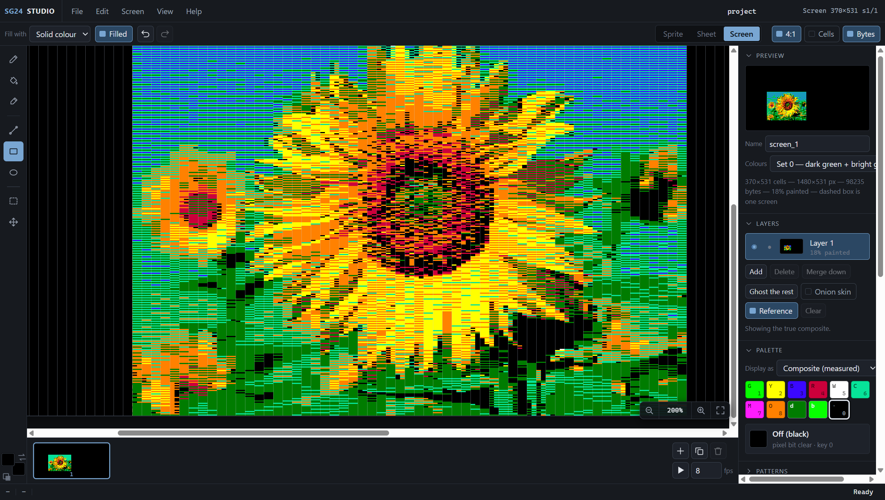
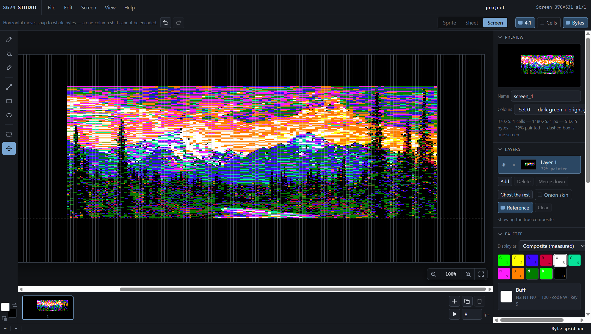
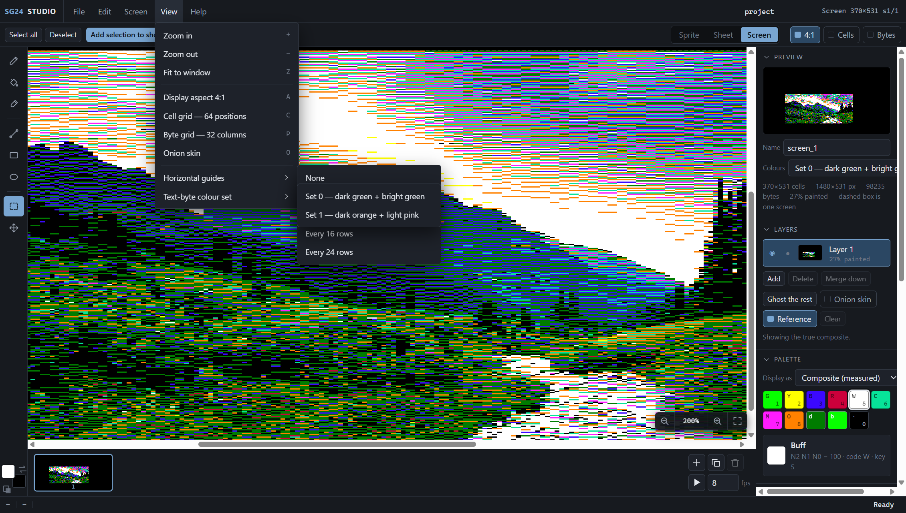
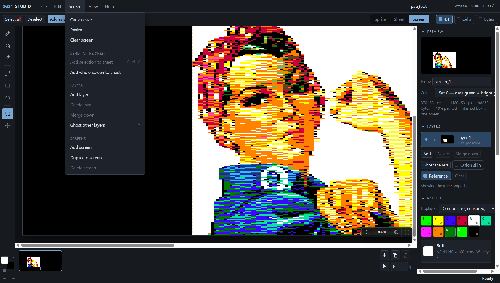
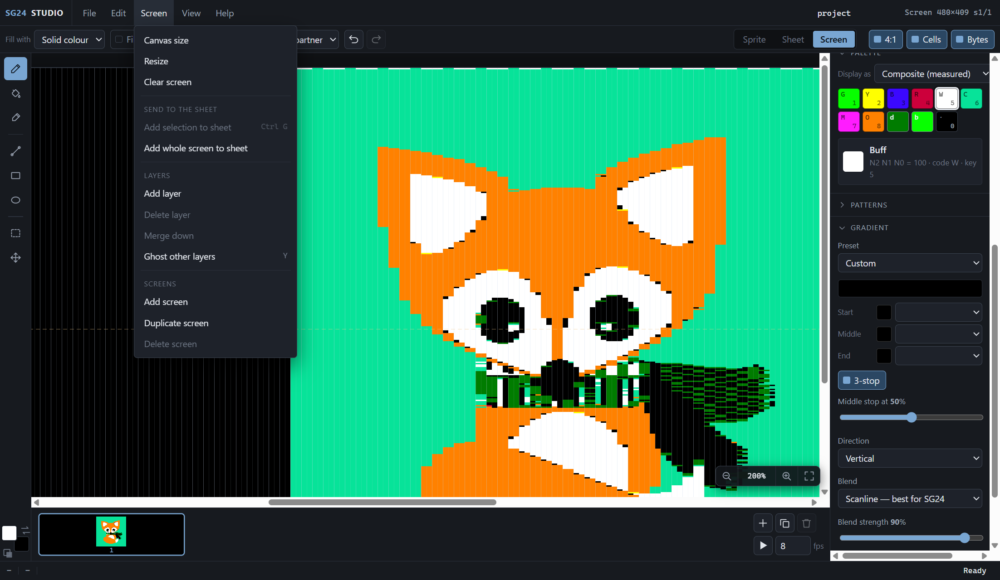
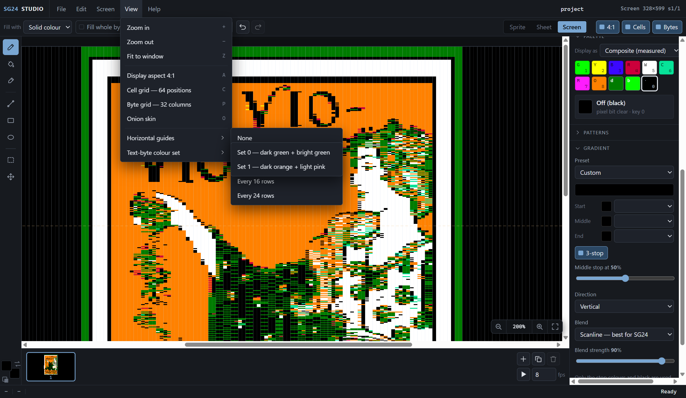
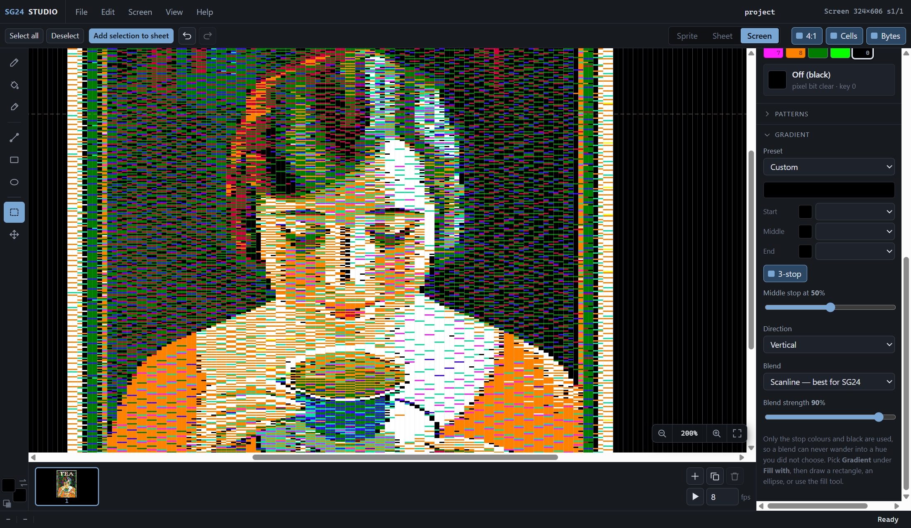

# SG24 Studio

SG24 Studio is a browser-based graphics editor for creating artwork, screens, sprite sheets, and animated sprites for the **MC6847 Semigraphics 24 (SG24)** display mode used by the **TRS-80 Color Computer (CoCo)**, **Dragon 32/64**, and compatible systems.

Unlike generic pixel editors, SG24 Studio understands the hardware rules of the MC6847 and the memory layout required by SG24. Every editing operation respects the format's restrictions so artwork can be exported directly for use on real hardware and emulators.



## Features

### Screen Editor

Create title screens, game maps, overlays, and other full-screen graphics.

- Multiple layers
- Onion skinning
- Image import and SG24 quantization
- Native SG24 palette and byte-aware editing
- Grid overlays for cells and bytes
- Pattern fills and gradients
- Assembly-friendly naming and export

### Sheet Editor

Convert artwork into reusable sprite assets.

- Guide-based slicing
- Automatic piece detection
- Piece management and preview
- Mirroring and rotation tools
- Sprite generation from extracted pieces

### Sprite Editor

Build animated sprite libraries.

- Multi-frame animation editing
- Onion skin preview
- Animation playback
- Sprite families and organization
- Sprite testing tools
- Sprite-sheet integration

### Import Pipeline

Import PNG, JPG, GIF, and WebP images and convert them into SG24-compatible artwork.

Options include:

- Cropping
- Scaling
- Dithering algorithms
- Palette reduction
- Letterboxing or canvas expansion
- RGB reference overlays for tracing

## What Makes SG24 Different?

Semigraphics 24 provides a **64 × 192** grid of cells.

Each cell is:

- 4 screen pixels wide
- 1 scanline tall

This produces the distinctive **4:1 aspect ratio** used throughout the editor.

```text
64 cells × 192 rows
= 256 × 192 displayed pixels
```

The editor displays artwork in the same proportions used by the hardware.

## Understanding the Byte Structure

An SG24 byte contains two horizontally adjacent cells that share a color:

```text
1 N2 N1 N0 UL UR LL LR
↑  chroma   ↑ top six / bottom six
MSB
```

Where:

- Bit 7 identifies the byte as a semigraphics byte.
- N2–N0 select one of eight chroma colors.
- UL and UR (bits 3 and 2) are the left and right cells on scanlines 0–5 of each 12-line character cell.
- LL and LR (bits 1 and 0) are the left and right cells on scanlines 6–11.

Bits 1–0 are **not** unused. The VDG is still in SG4 and draws a 12-scanline cell, so a byte that sets only bits 3–2 leaves the bottom half of every cell black. SG24 Studio writes the same pair into both halves: a lit left cell is bit 3 plus bit 1 (`$0A`), a lit right cell is bit 2 plus bit 0 (`$05`). Code that writes SG24 bytes at run time, such as sprite blitters, must do the same.

Because two neighboring cells share the same chroma, cells can only differ in color when a byte boundary falls between them. SG24 Studio automatically resolves these hardware constraints while drawing.

A standard screen contains:

- 64 columns
- 192 rows
- 32 bytes per row
- 6144 bytes total

## The Twelve-Color Hardware Palette

Although SG24 itself provides eight chroma colors, additional colors are available through text-mode blank characters.

### Color Set 0

- Dark Green
- Bright Green

### Color Set 1

**CoCo 1 / CoCo 2**

- Dark Red
- Light Pink

**CoCo 3**

- Dark Orange
- Orange

Together these provide the effective twelve-color hardware palette:

- Eight SG24 chromas
- Black
- Dark Green
- Two color-set shades

The editor includes support for these colors and can preview artwork using different display variants.

## Hardware Notes

SG24 is not a native MC6847 video mode.

It is produced by feeding a larger buffer through the SAM while the VDG operates in Semigraphics mode. Because of this:

- SG24 works on the Color Computer 1 and 2.
- SG24 works on Dragon systems.
- SG24 does not display correctly on a stock CoCo 3 because the GIME only supports standard SG4 behavior.

Projects created in SG24 Studio are intended for systems that support the traditional SAM/VDG implementation.

## Philosophy

SG24 Studio is designed around a simple idea:

> Let artists work visually while the editor handles the hardware limitations.

Instead of forcing users to think in terms of byte pairs, chroma sharing, and display quirks, the editor automatically enforces SG24 rules while preserving complete control over the final image.

The result is artwork that looks correct, exports cleanly, and remains faithful to the capabilities of the original hardware.

## Gallery

<table>
  <tr>
    <td width="50%"><br><sub>Landscape artwork with the byte grid and Move tool, which snaps to whole bytes.</sub></td>
    <td width="50%"><br><sub>View menu: grids, onion skin, horizontal guides and text-byte colour sets.</sub></td>
  </tr>
  <tr>
    <td width="50%"><br><sub>Screen menu: canvas size, layers, multiple screens and sending art to the sheet.</sub></td>
    <td width="50%"><br><sub>Gradient fills with scanline blending, tuned for SG24.</sub></td>
  </tr>
  <tr>
    <td width="50%"><br><sub>Imported poster artwork quantized to the SG24 palette.</sub></td>
    <td width="50%"><br><sub>Selection tool for sending regions of a screen to the Sheet Editor.</sub></td>
  </tr>
</table>
